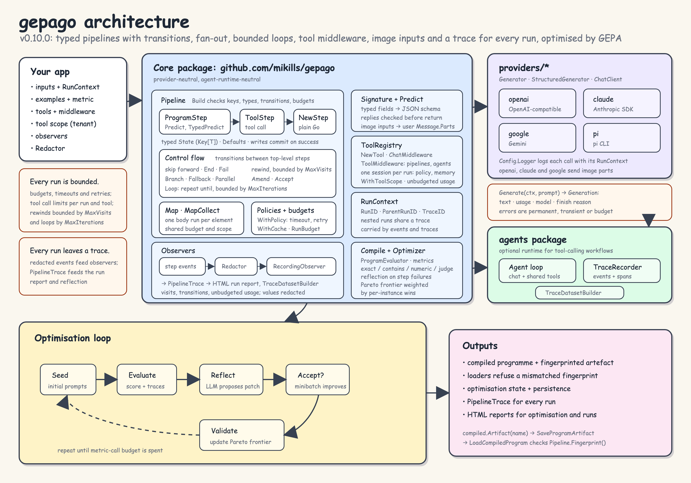

# gepago

`gepago` is a Go SDK for GEPA-style reflective optimisation and for running the flows it optimises.
It helps you improve prompts, policies, tool descriptions, and other text components
using evaluation feedback, and runs them as typed pipelines with bounded model calls, tools,
per-step policies and a trace for every run.

Original paper:
[GEPA: Reflective Prompt Evolution Can Outperform Reinforcement Learning](https://arxiv.org/abs/2507.19457).



## What it can do

- Call any model through the provider-neutral `Generator` interface, with usage, the resolved model and a finish reason on every call.
- Ask for structured output: typed signature fields, strict JSON schemas, native structured output where the provider has it, and validation before a reply is returned.
- Build typed `Pipeline`s with retries, timeouts, forward skips, bounded rewinds, branches, fallbacks and parallel steps. Add run-time fan-out with `Map`, bounded repeats with `Loop`, step caching and run budgets.
- Give model steps tools from a registry, under a per-run policy with call limits and caching, with the caller's scope, such as a tenant, on every call.
- Wrap tool calls in tool middleware. It wraps every tool call that a pipeline run or an agent run makes through its own session. Write limiting, logging, auditing and fallback once, not in each tool.
- Send PNG, JPEG and WebP images in user chat messages to the OpenAI, Claude and Google chat clients, and as `Predict` and `TypedPredict` inputs.
- Observe every run with events, recorded traces, HTML run reports, a run context and redaction.
- Run optional agent loops from the composable `agents` package, with full trace events for runs, turns, LLM calls, tool calls, errors, and run completion.
- Track usage with spans and ledgers instead of relying only on turn counts.
- Persist traces, run results, optimisation events, and optimiser state to files.
- Optimise named text candidates such as prompts, tool descriptions, routing rules, and policies.
- Load parsed text documents into examples for extraction-focused optimisation.
- Build reflective datasets from evaluation feedback, pipeline traces and agent traces.
- Use built-in exact-match, contains, numeric, classification, and LLM judge metrics.
- Compile a `Predict`, `ChainOfThought`, `TypedPredict` or `Pipeline` from examples, a metric, and a reflection model.
- Select candidates from a Pareto frontier or current-best strategy, accept or reject them with configurable score criteria, and resume optimisation from persisted state.
- Save trained candidates as fingerprinted artefacts and load them at runtime.
- Use optional OpenAI, Claude, Google/Gemini or pi providers.
- Generate self-contained HTML reports for optimisation runs and pipeline runs.

## Package layout

```text
github.com/mikills/gepago                  core optimiser, programme and pipeline layer
github.com/mikills/gepago/agents           optional evented agent runtime
github.com/mikills/gepago/gepatest         test kit: fake models and trace assertions
github.com/mikills/gepago/providers/openai OpenAI and OpenAI-compatible provider
github.com/mikills/gepago/providers/claude Anthropic Claude provider
github.com/mikills/gepago/providers/google Google Gemini provider
github.com/mikills/gepago/providers/pi     pi CLI provider
packages/gepago/wasm                       Node.js ESM WASM packages
```

The root package is intentionally provider-neutral and does not depend on the agent runtime.
Use subpackages only for the integrations you need. The module requires Go 1.27.1 or later.

## Core flow

GEPA optimises text, not model weights. You provide a candidate text bundle, evaluation cases, and feedback. The optimiser turns failures into reflection records, asks a model for a patch, evaluates the patch, and keeps useful candidates on a frontier.

```text
Candidate text -> rollout/evaluate -> feedback/traces -> reflection -> patch -> frontier
```

## Models

Every model call goes through `Generator`:

```go
type Generator interface {
    Generate(ctx context.Context, prompt string) (gepa.Generation, error)
}
```

A `Generation` holds the reply `Text`, its `Usage` (prompt, completion, reasoning and cached tokens), the `Model` the provider resolved, and a `FinishReason`: `stop`, `length`, `tool_calls` or `content_filter`. A call that fails after the provider spent tokens returns that usage with the error, so it is recorded exactly once. `Predict` fails with `ErrOutputTruncated` on a truncated reply and `ErrContentFiltered` on a refusal rather than repairing them.

Provider errors carry a kind: `gepa.IsTransient` (429, 5xx and network errors), `gepa.IsPermanent` (other 4xx) or `gepa.IsBudget` (a run budget is spent). `RetryingLanguageModel` retries transient errors only, with capped exponential backoff and jitter, and stops when its context ends.

Use `gepa.GeneratorFunc` to turn a function into a `Generator`, and `gepa.AdaptLanguageModel` to wrap an older `LanguageModel` that returns a string.

## Programme layer

For common prompt-optimisation workflows, define a task signature, a `Predict` programme,
examples, and a metric:

```go
program := gepa.Predict{
    Signature: gepa.Signature{
        Name:    "sentiment",
        Inputs:  []gepa.Field{{Name: "text"}},
        Outputs: []gepa.Field{{Name: "label"}},
    },
    Instruction: "Classify the sentiment.",
    LM:          lm, // any gepa.Generator
}

examples := []gepa.Example{
    gepa.NewIOExample(
        "positive-service",
        gepa.Prediction{"text": "I loved the fast service."},
        gepa.Prediction{"label": "positive"},
    ),
    gepa.NewIOExample(
        "negative-quality",
        gepa.Prediction{"text": "The product broke immediately."},
        gepa.Prediction{"label": "negative"},
    ),
}

split, err := gepa.SplitExamples(examples, gepa.SplitConfig{ValidationSize: 1, Shuffle: true, Seed: 1})
if err != nil {
    // handle error
}

config := gepa.DefaultCompileConfig(
    program,
    split.Train,
    split.Validation,
    gepa.ExactMatchMetric{Fields: []string{"label"}},
    lm,
)
compiled, state, err := gepa.Compile(ctx, config)
```

Use `ChainOfThought` when the programme should expose a concise reasoning field.
Use `DemosFromExamples` and the `demos` component when you want examples optimised with the instruction.
Use `LLMJudgeMetric` when exact labels are too rigid for the task.

## Structured output

Give signature fields a `Type`, a Go kind name such as `"string"`, `"int"`, `"float64"`, `"bool"`, `"slice"` or `"map"`, or an explicit JSON `Schema`, and mark outputs the reply may leave out as `Optional`:

```go
signature := gepa.Signature{
    Name:   "extract_amount",
    Inputs: []gepa.Field{{Name: "document", Type: "string"}},
    Outputs: []gepa.Field{
        {Name: "amount", Type: "int"},
        {Name: "note", Type: "string", Optional: true},
    },
}
```

`Signature.JSONSchema` returns the strict reply schema. Providers that implement `StructuredGenerator` (OpenAI and Claude) receive it as the response format; others get it in the prompt. `Predict` checks every reply before returning it: a missing or null required output, an extra field or a value that does not fit its `Type` fails with `ErrInvalidOutput` naming the field, and the repair prompt carries the schema.

`TypedPredict[In, Out]` works with Go structs and decodes the reply with the strict rules `Key.Get` uses:

```go
type Document struct {
    Document string `json:"document"`
}

type Extraction struct {
    Amount int    `json:"amount"`
    Note   string `json:"note,omitempty"`
}

extract := gepa.TypedPredict[Document, Extraction]{
    Signature:   gepa.Signature{Name: "extract_amount"},
    Instruction: "Extract the obligation amount.",
    LM:          lm,
}
result, err := extract.Run(ctx, Document{Document: "Bond obligation for 125,000."})
```

### Image inputs

A `Predict` or `TypedPredict` input can hold a `gepa.Image` (see [Images in chat messages](#images-in-chat-messages)), at any depth. Give a top-level image input the `Type` `"image"`, so `Validate` and `Build` check it. A `TypedPredict` derives that `Type` for an `In` field of type `gepa.Image`. Tag the field `omitempty` or `omitzero` to make the image optional: a zero `gepa.Image` there sends no image. Such an optional field takes a `*gepa.Image` key in a pipeline, nil for no image, since `State` refuses the zero `Image`. A required field takes a `Key[gepa.Image]`:

```go
type Figure struct {
    Chart gepa.Image `json:"chart" description:"the chart to read"`
    Title string     `json:"title"`
}

read := gepa.TypedPredict[Figure, Extraction]{
    Signature: gepa.Signature{Name: "read_chart"},
    LM:        chatModel, // a gepa.ChatClient
}
result, err := read.Run(ctx, Figure{Chart: chart, Title: "Q3 revenue"})
```

A call with images chats, also without tools. Its one user message has an empty `Content`. Its `Parts` hold, for each distinct image, the text `[image N]` and then the image. The last part is the prompt. A `ChatClient` or `ChatMiddleware` that reads only `Content` sees no prompt in such a call, so read the text parts too. In the prompt's input JSON each image is its label, such as `"chart": "[image 1]"`, and `BuildPrompt` returns that text. The repairs continue the same chat, so the images stay in its first message. The model must be a `ChatClient`. With another model, such as `providers/pi`, an input of `Type` `"image"` fails `Validate`. An image in any other input fails the run before any call. Both fail with a Permanent `ErrImagesUnsupported`. Demos cannot hold images. A reply cannot carry one either, so a `TypedPredict` `Out` field of type `gepa.Image` fails `Validate`. Elsewhere in `Out`, such as in a `Message` part, a reply that gives an image a value fails to decode with `ErrInvalidImage`. The repair loop then asks again. Inputs without images send the same request as before.

gepago checks images against values, not types. Only the `Type` `"image"` and some `ToolStep` reads fail `Build`. Such a read has the type `gepa.Image`, or pointers, slices, arrays or map values that end at `gepa.Image`. `ToolRegistry.Register` also refuses a `NewTool` whose `Args` no JSON value can decode into, such as a required `gepa.Image` field. Every other image in tool arguments or output fails at call time, when a value holds one. Apart from these refusals, a type that holds an image in a struct field works as in v0.9.0 while its values hold no image. Examples are `gepa.Message` and `gepa.Part`.

In a pipeline, read an image input from a `Key[gepa.Image]`. `Key.Get` converts between `gepa.Image` and `*gepa.Image`, and into structs, slices, maps and `any` values that hold images. It puts each image back where the stored value held it. An image reaches the model, and comes back from `Key.Get`, only where `encoding/json` meets it as a `gepa.Image`. Behind a type's own `MarshalJSON` it is that method's JSON, the summary. So `Predict` sends no image for it, and `Key.Get` into an `any` gives the summary as a map. Traces, reports, `WithCache` keys, optimiser fingerprints and reflection records hold the image's summary, never its data. A `Redactor` gets the `gepa.Image` under its key. When the Redactor changes it, gepa removes the image's summary text and JSON from error messages.

## Pipelines

For multi-step workflows, build a `Pipeline` from a `PipelineSpec`. Each step that wraps a programme has its own scoped components such as `extract.instruction`, so GEPA can improve the steps independently while `Compile` still sees one programme.

```go
document := gepa.Key[string]{Name: "document"}
amount := gepa.Key[int]{Name: "amount"}
decision := gepa.Key[string]{Name: "decision"}

extractProgram := gepa.Predict{
    Signature: gepa.Signature{
        Name:    "extract_amount",
        Inputs:  []gepa.Field{{Name: "document"}},
        Outputs: []gepa.Field{{Name: "amount", Type: "int"}},
    },
    Instruction: "Extract the obligation amount.",
    LM:          lm,
}

pipeline, err := gepa.PipelineSpec{
    Inputs: []gepa.KeyRef{document.Ref()},
    Steps: []gepa.Step{
        gepa.NewProgramStep("extract", extractProgram, []gepa.KeyRef{document.Ref()}, []gepa.KeyRef{amount.Ref()}),
        gepa.NewStep("decide", []gepa.KeyRef{amount.Ref()}, []gepa.KeyRef{decision.Ref()}, func(_ context.Context, s gepa.State) error {
            value, err := amount.Get(s)
            if err != nil {
                return err
            }
            if value > 100000 {
                decision.Set(s, "needs_review")
            } else {
                decision.Set(s, "approve")
            }
            return nil
        }),
    },
}.Build()
```

Steps declare the keys they read and write as `KeyRef`s, which carry the value type. `Build` checks the contract once:

- every key a step reads is a pipeline input, has a `Default` or is written by an earlier step, with the same type
- a key written by more than one step needs a `MergeRule`, unless transitions keep any run from committing both writes
- pipeline inputs are read-only, and no `Default` may name one

`PipelineSpec.Defaults` seed keys before the first step, so every step sees a default until a committed write replaces it; each run gets its own copy. A `MergeRule` combines writes only: the first write of a key replaces its default rather than merging with it.

At run time each step only sees the keys it declared. Its writes must have the declared type, and they are copied into state only when the step succeeds. Values are copied whenever they cross into or out of state, so a step cannot change an input or an earlier result through a shared map or slice. A run fails when its inputs hold a key not declared in `Inputs`, unless `AllowExtraInputs` is set, and input values are converted to their declared types before the first step runs.

`NewProgramStep` copies only the declared outputs from a programme's reply into state, so a model cannot overwrite a document or record identifier. For `Predict`, `ChainOfThought` and `TypedPredict` the signature's inputs must be exactly the declared reads and its outputs exactly the declared writes, with the Go types the signature gives them; a `ChainOfThought` may also declare its reasoning field, and a `TypedPredict` step may leave out the optional fields of `Out`. A reply that omits a declared output, sets it to null or gives a value that does not fit its type fails the step with `ErrInvalidOutput`, unless the signature marks that output `Optional`, in which case the step stores the zero value of the key's type. During `Compile` such an example scores zero, with the failing step, its reads and the error as reflection feedback, instead of stopping optimisation. Deterministic steps built with `NewStep` take no candidate; only steps that carry components appear in `SeedCandidate`.

`Key.Get` converts model output into `T` strictly: unknown fields, fields that match only by case, missing fields not tagged `omitempty` and nulls in non-nullable positions are errors, not zero values. If `T` has a `Validate() error` method, `Get` calls it too.

`Run` and `RunCandidate`, which `Compile` uses, return the state without the inputs: the values the steps wrote and the defaults no write replaced; `RunState` also returns the inputs. A failed run returns that state as it stood before the failing step, defaults included, together with a `*StepError` naming it and holding the values it read. A step can attach diagnostics with `WithStepDetails`, a panicking step's stack is kept under `Details["stack"]`, and usage from a failed model call is still recorded.

This mirrors the GEPA paper's compound-system formulation `Φ = (M, C, X, Y)`: the `Pipeline` is `Φ`, each step is a language module `Mᵢ`, each wrapped `Predict` carries the prompt and local input/output schema `(πᵢ, Xᵢ, Yᵢ)`, and the steps and their control flow are `C`.

### Control flow, policies and budgets

A run executes the top-level steps in order. `PipelineSpec.Transitions` change where it goes next: when step `From` finishes, its transitions are tried in the order declared, those with `OnError` if it failed and the others if it succeeded, and the first whose `When` holds sends the run `To` another top-level step, `gepa.End` or `gepa.Fail`. With no match, a step that succeeded is followed by the next one and a step that failed fails the run. A failed step's writes are always dropped.

```go
hint := gepa.Key[string]{Name: "hint"}
approved := gepa.Key[bool]{Name: "approved"}

extract := gepa.WithAmendable(gepa.NewProgramStep("extract", gepa.Predict{
    Signature: gepa.Signature{
        Name:    "extract_amount",
        Inputs:  []gepa.Field{{Name: "document"}, {Name: "hint"}},
        Outputs: []gepa.Field{{Name: "amount", Type: "int"}},
    },
    Instruction: "Extract the obligation amount. Follow the hint, if any.",
    LM:          lm,
}, []gepa.KeyRef{document.Ref(), hint.Ref()}, []gepa.KeyRef{amount.Ref()}), hint.Ref())
review := gepa.NewStep("review", []gepa.KeyRef{amount.Ref()}, []gepa.KeyRef{approved.Ref()}, askReviewer)
decide := gepa.NewStep("decide", []gepa.KeyRef{approved.Ref()}, []gepa.KeyRef{decision.Ref()}, recordDecision)

noAmount := func(s gepa.State, _ error) bool { v, err := amount.Get(s); return err != nil || v == 0 }
small := func(s gepa.State, _ error) bool { v, err := amount.Get(s); return err == nil && v < 1000 }

pipeline, err := gepa.PipelineSpec{
    Inputs: []gepa.KeyRef{document.Ref()},
    Steps:  []gepa.Step{extract, review, decide},
    Transitions: []gepa.Transition{
        // no amount: extract again with a hint, and keep that visit only if it found one
        {
            From:   "extract",
            When:   noAmount,
            To:     "extract",
            Amend:  func(s gepa.State) error { hint.Set(s, "The amount may be written in words."); return nil },
            Accept: func(_, next gepa.State) bool { return !noAmount(next, nil) },
        },
        // small amounts skip the review
        {From: "extract", When: small, To: "decide"},
    },
    MaxVisits: map[string]int{"extract": 2},
    Defaults:  []gepa.Default{gepa.DefaultValue(hint, ""), gepa.DefaultValue(approved, true)},
}.Build()
```

`Build` enforces three constraints:

- A forward target is a later top-level step, `End` or `Fail`. The steps in between do not run and emit no events.
- An earlier target, or `From` itself, is a rewind: the run goes back and runs every step from the target to `From` again. The target needs a `MaxVisits` of at least 2, and a rewind that would exceed it fails `From` with `ErrMaxVisits`, which an `OnError` transition can catch.
- One rewind range at a time: two rewinds must have the same target and `From`, or ranges that do not overlap; nested ranges are not supported. Transitions name top-level steps only.

A step that a transition skips over, or that has an `OnError` transition to a later step or `End`, may not write. A key is guaranteed at a step when it is an input, has a `Default` or is written by an earlier step that always writes, and `Build` fails on any read of a key that is not guaranteed, naming the step and the key. A key written by a step that may not write needs a `Default` if any later step reads it, even when another step always writes it. Above, `review` may be skipped, so `decide` can read `approved` only because it has a default.

On a rewind, `Amend` may set only the keys the target declared with `WithAmendable`; the target reads them on its next visit only, and they are never committed. When the run reaches `From` again, `Accept(prev, next)` compares the values the range wrote before and after: true keeps the new ones, false restores the old ones, emits `RewindRejected` and goes on past `From`. The usage of every visit counts. Step events carry the visit in `Attributes["visit"]`, and a `TransitionObserver`, such as `RecordingObserver`, also receives `TransitionTaken` and `RewindRejected`.

`Branch` and `Fallback` build a `Flow` of ordinary steps and transitions, which `PipelineSpec.Add` appends:

```go
reads, writes := []gepa.KeyRef{document.Ref()}, []gepa.KeyRef{amount.Ref()}
extract := gepa.WithPolicy(
    gepa.NewProgramStep("extract", extractProgram, reads, writes),
    gepa.StepPolicy{Timeout: 20 * time.Second, Retry: gepa.RetryPolicy{MaxAttempts: 3}},
)

spec := gepa.PipelineSpec{
    Inputs:   []gepa.KeyRef{document.Ref()},
    Defaults: []gepa.Default{gepa.DefaultValue(amount, 0)},
    Budget:   gepa.RunBudget{MaxDuration: time.Minute, MaxModelCalls: 6, MaxTokens: 20000},
}
spec.Add(
    gepa.Fallback("extracted", extract, gepa.NewProgramStep("extract_small", smallProgram, reads, writes)),
    gepa.Branch("route", route, map[string]gepa.Step{"review": review, "approve": approve}, amount.Ref()),
)
pipeline, err := spec.Build()
```

- `Branch` calls `route` once, writes the chosen label to a string key named after the branch and runs the arm with that label; all arms write the same keys. `Fallback` runs its secondary step when the primary fails with an error that is not Permanent. Arms and a fallback's steps are top-level steps that may not write, so a later reader of their keys needs a `Default`, as `amount` has here. Budget the arms or steps by name.
- `WithPolicy` gives a step a per-attempt `Timeout` and retries of Transient errors (`Retry{MaxAttempts, Backoff}`). A step that still fails fails the run unless an `OnError` transition takes it elsewhere.
- `Parallel` runs steps with disjoint writes concurrently and commits them together, and `WithCache` reuses a step's result within a run when its key function returns a key it has seen.
- `RunBudget` limits a run's duration, model calls, tokens and tokens per step, summed over every visit; exceeding a limit fails with a `Budget` error naming it. A step reads what is left with `gepa.BudgetFrom(ctx).Remaining()`.

`Map` and `MapCollect` run a body step once per element of a list known only at run time:

```go
pages := gepa.Key[[]string]{Name: "pages"}
page := gepa.Key[string]{Name: "page"}
found := gepa.Key[int]{Name: "found"}
readings := gepa.Key[[]gepa.MapResult[int]]{Name: "readings"}

readPage := gepa.NewProgramStep("read_page", pageProgram, []gepa.KeyRef{page.Ref()}, []gepa.KeyRef{found.Ref()})
read := gepa.MapCollect("read", pages, page, readPage, readings, gepa.MapOptions{MaxConcurrency: 4, MaxItems: 200})
```

The body reads the element under `page` and writes exactly one key; each element runs on its own view of that key and the guaranteed keys the body reads, at most `MaxConcurrency` at a time, and more than `MaxItems` elements fail the step before any runs. `Map` writes the outputs in input order and fails fast: the first failure cancels the other elements and commits nothing. `MapCollect` runs every element and writes a `MapResult{Index, Value, Error, Usage, Duration}` for each, so a later step can tell what is missing, except that a `Budget` error in an element or the end of the run's context fails the step. Elements share the run's budget and tool scope, and their events carry `Attributes["index"]`. A `Redactor` that hides the items key hides each element's item, and one that hides the results key each element's output, in events and reflection. A body has no transitions; a rewind that reaches the Map runs every element again.

[`examples/map_reduce`](examples/map_reduce) puts skips, `MapCollect`, a rewind with `Amend` and `Accept`, and a scoped tool into one runnable pipeline.

`Loop` runs a body step, and runs it again until a typed condition on the state holds, at most `MaxIterations` times in all:

```go
pages := gepa.Key[[]string]{Name: "pages"}
page := gepa.Key[int]{Name: "page"}
total := gepa.Key[string]{Name: "total"}

readPage := gepa.NewProgramStep("read_page", pageProgram, []gepa.KeyRef{pages.Ref(), page.Ref()}, []gepa.KeyRef{total.Ref()})
done := func(s gepa.State) (bool, error) {
    found, err := total.Get(s)
    if err != nil {
        return false, err
    }
    n, err := page.Get(s)
    if err != nil {
        return false, err
    }
    list, err := pages.Get(s)
    return found != "" || n == len(list), err
}
scan := gepa.Loop("scan", readPage, done, gepa.LoopOptions{MaxIterations: 50, Iteration: page})
```

Each iteration runs the body on its own view of the keys it reads. `Iteration` holds the number of the iteration, from one, and never reaches the state. A key that the body reads and writes carries from one iteration to the next, and starts from its `Default` or an earlier write. A `Default` is the usual seed. An earlier write also needs a `MergeRule`. The Loop's value already holds the seed, so a rule that adds or appends counts the seed twice. After each iteration the condition (`done` here) reads the body's keys. When it holds, the Loop commits the writes of that iteration. `Build` refuses a Loop without `MaxIterations` or a condition, and a body that writes nothing. A Loop that reaches its cap fails with a Permanent error that wraps `ErrMaxIterations` and commits nothing, and an `OnError` transition can catch it. So write the condition to hold when the work ends, found or not, and keep the cap as a guard. A failed iteration fails the Loop with the kind of its error and commits nothing. Cancellation or a spent budget stops the Loop before the next iteration. Each iteration sees the tool memory and cached tool results of the iterations before it, and its events carry `Attributes["iteration"]`. A `Redactor` that hides the iteration key also hides that attribute and the Loop's `"iterations"`. Events, traces and the run report then leave them out. The Loop's error names the running iteration, so the run keeps that number in error text where the iteration reads the key. It also keeps it where a nested pipeline takes the number as an `int` input under the key's name. The run redacts any other value under that name, such as a `Default` or a write, as any other value. When another hidden value has the same text, the run still removes the number. It removes it from the events of the whole trace and from reflection for the whole example. A Loop can be the body of a `Map` or `MapCollect`. There the keys it writes cannot have a seed. To carry a key in each element, run the Loop in a nested pipeline whose `Defaults` seed it. Then make `NewProgramStep` of that pipeline the Map's body. To retry a step, use a rewind with `MaxVisits` instead.

### Host integration

Use `MapCollectUntil` to read items in order and stop after a terminal result.
It takes the `MapCollect` arguments followed by `func(MapResult[Out], error) bool`.
A true result retains completed results and marks unstarted entries `Skipped`.
It accepts concurrency zero or one. Budget failures, timeouts and recovered panics remain fatal.
A successful terminal result may be retained after caller cancellation. Ordinary `MapCollect` keeps its existing behaviour.

Pass `PreserveExistingOutputs(key.Ref())` to `NewProgramStep` to retain a prior value when the programme omits that output.
The key must be an available declared write. A signed programme must mark it optional.
Explicit zero and null values still follow the normal output checks.
Preserved dependencies enter the step's reads, but do not add inputs to the programme's prompt.

Set `Predict.OutputPolicy`, `TypedPredict.OutputPolicy` or `ChainOfThought.OutputPolicy` to `AcceptValidTruncatedOutput` to accept a complete, validated token-limit reply.
The default remains `RejectTruncatedOutput`.
The opt-in policy checks the output schema, rejects incomplete output without repair, and keeps the provider's finish reason.
Content-filtered replies still fail.

A recovered execution panic is available through `errors.As` as `*PanicError`, with its original `Value` and `Stack`.
Redacted observations do not expose those fields.

`PipelineSpec.Finalizer` runs host bookkeeping once after a started run ends, before `RunFinished`:

```go
spec.Finalizer = &gepa.PipelineFinalizer{
    Timeout: 5 * time.Second,
    Run: func(ctx context.Context, state gepa.State, runErr error) error {
        return recordCompletion(ctx, state.Prediction(), runErr)
    },
}
```

The callback receives read-only committed state, including inputs and defaults.
Its context ignores caller cancellation and has its own positive timeout.
It does not inherit pipeline observation, usage collection, budgets or tool sessions.
Its error matches `ErrFinalization` and joins the original run error. It cannot turn failure into success or change pipeline outputs.
The timeout is cooperative, so the callback must respect its context.
Invalid inputs do not start a run and do not call the finalizer.

## Tools

Register tools once and refer to them by name:

```go
type lookupArgs struct {
    Customer string `json:"customer"`
}

lookup := gepa.NewTool("lookup_customer", "Look up a customer's plan.",
    func(ctx context.Context, args lookupArgs) (Plan, error) {
        return store.Plan(ctx, args.Customer)
    })
tools, err := gepa.NewToolRegistry(lookup)
```

`NewTool` derives the argument schema from `Args` and encodes `Out` as the result. `NewToolFunc` takes a hand-written schema. In a pipeline, set `PipelineSpec.Tools`. Then call a tool deterministically with `gepa.ToolStep("lookup", "lookup_customer", reads, writes)`, or give a `Predict` step a bounded tool loop with `Predict.Tools`. Its `LM` must be a `ChatClient`, which the OpenAI, Claude and Google providers are. `PipelineSpec.ToolPolicy` sets the run's allow-list, total and per-tool call limits and result cache, and a tool's memory writes commit only with its step's writes. `Build` fails on a tool that is not registered or not allowed. Chat middleware registered with `RegisterMiddleware` wraps a step's or an agent's chat client by name, outermost first. A middleware or a chat client that reads the text of a request must read each message's `Parts` as well as its `Content`. A `Predict` with image inputs sends its prompt as the last text part of a message with an empty `Content`.

Tool arguments and output travel as JSON, and the JSON form of an `Image` holds no image data. So an `Image` in the output of a `NewTool` fails the call with a Permanent error. Arguments that give an `Image` of `Args` a value fail the call with `ErrInvalidImage`. A `ToolStep` read whose value holds an `Image` fails the step with a Permanent error. A type that embeds an `Image` or a `*Image`, or that writes its own JSON, encodes as `json.Marshal` writes it. So the model gets at most the image's summary, and never the image. But a `MarshalJSONTo` that encodes an `Image` it holds through its encoder still fails. In the schema that a model follows, an image position takes only null.

Tools often act for someone: a tenant, a user, an account. Set that scope on the run's context and every tool call of the run carries it as `ToolCall.Scope`, from a `ToolStep`, a `Predict` tool loop, a `Map` element or an agent. The model never sees it, and gepago never inspects it.

```go
ctx = gepa.WithToolScope(ctx, Tenant{ID: tenantID})
out, err := pipeline.Run(ctx, inputs)
```

A `NewTool` function or an agent's `ToolBinding` handler reads the scope with `gepa.ToolScopeFrom(ctx)`; any other `ToolProvider` reads it from the call:

```go
func (t crmTool) Invoke(ctx context.Context, call gepa.ToolCall) (gepa.ToolResult, error) {
    tenant, ok := call.ScopeAs[Tenant]()
    if !ok {
        return gepa.ToolResult{}, gepa.PermanentError(errors.New("crm: the run has no tenant"))
    }
    record, usage, err := t.lookup(ctx, tenant, call.Arguments)
    if err != nil {
        return gepa.ToolResult{}, err
    }
    return gepa.ToolResult{
        Output:          record.JSON,
        Provenance:      []gepa.Provenance{{Kind: "customer", ID: record.ID, Source: record.URL}},
        UnbudgetedUsage: usage, // billed to the tenant, not the run
    }, nil
}
```

In-process the scope is passed as it is, so any value works. A call that crosses a process boundary, such as to a remote tool host, carries the scope's JSON form, so the scope must be JSON-marshalable, and `ScopeAs` on the decoded call sees that form (a `map[string]any` for a struct), not your type. A `ToolPolicy` cache answers by tool and arguments whatever the scope, so give each run one scope.

A tool reports usage it did not record itself in `ToolResult.Usage`, which counts against the run's budget, and usage the run should see but not count, such as a call billed elsewhere, in `UnbudgetedUsage`; other code records the latter with `gepa.RecordUnbudgetedUsage(ctx, usage)`. Events, spans and traces report it apart from `Usage`, as `Unbudgeted`, and `RunWithUsage` returns both together. A tool that records its usage itself must not report it again.

`Provenance` names a protected resource the result touched (`Kind` and `ID`, for audit), where it came from (`Source`, with `Detail` locating the part used), or both. An entry that names neither, has only one of `Kind` and `ID`, or has `Detail` without `Source` fails the call (see `Provenance.Validate`).

### Tool middleware

Tool middleware wraps every tool call that the run's own session makes. Write limiting, logging, auditing and fallback once, not in each tool. Register the middleware by name and attach it to a pipeline with `PipelineSpec.ToolMiddleware` or to an agent with `Agent.ToolMiddleware`. The first name is the outermost wrapper.

```go
audit := func(next gepa.ToolProvider) gepa.ToolProvider {
    return gepa.NewToolFunc(next.Schema(), func(ctx context.Context, call gepa.ToolCall) (gepa.ToolResult, error) {
        start := time.Now()
        result, err := next.Invoke(ctx, call)
        slog.InfoContext(ctx, "tool call", "tool", call.Name, "duration", time.Since(start), "failed", err != nil)
        return result, err
    })
}
err := tools.RegisterToolMiddleware("audit", audit)
if err != nil {
    return err
}
spec := gepa.PipelineSpec{Tools: tools, ToolMiddleware: []string{"audit"} /* inputs, steps */}
```

The middleware runs inside the run's `ToolSession`. It sees only the calls the session invokes. It does not see unknown, disallowed or refused calls, or calls the cache answers. A retry inside the middleware is one call, one record and one unit of `MaxCalls`. The session checks, caches and applies the result the middleware returns, so a fallback result counts as the tool's result. The middleware's context carries the run's tool scope, tool memory, `RunContext`, step path and budget.

Each call to `next` is an attempt that runs the tool once. An attempt belongs to the call whose context it carries, so pass `ctx`, or a context derived from it, to `next`. The first attempt of a call is the first attempt that carries its context. An attempt whose context carries no call of the tool fails, and so does an attempt that starts after its call has returned. When the middleware returns, the call cancels the attempts that still run and waits for them. So a timeout in middleware cannot bound a tool that ignores its context.

Each attempt records its usage with `RecordUsage` and `RecordUnbudgetedUsage` as soon as it returns, as the session records a call without middleware. The call's record shows the usage of all its attempts. The middleware may return the result of one of its own call's attempts as it is. Any other result it returns must carry no usage, or the call fails. So a middleware that reuses a result across calls, such as a cache or a singleflight, must return that result without usage. The error of such a call keeps the kind of the error that the middleware returned. It is Permanent when the middleware returned no error or an unclassified error. Middleware that spends tokens itself records them with `gepa.RecordUsage` or `gepa.RecordUnbudgetedUsage`. The first attempt always runs. A later attempt fails with the context's cause when its context has ended. The run's budget refuses a later attempt as it refuses a model call. It refuses one when the tokens of the run or the step exceed a limit. It also refuses one when the run has reached `MaxDuration` or has already failed with a budget error. A spent `MaxModelCalls` does not refuse an attempt.

An attempt turns a panic of the tool into the error `tool panicked: ...`. It fails output that is not valid JSON and provenance that is not valid with the session's errors. So the middleware sees these failures and can fall back.

The middleware must keep the schema of the tool it wraps. `Build` applies it to each tool the pipeline's steps name, and `Agent.Validate` to each tool of the agent. Both fail on middleware that panics, returns nil or changes a schema. A run applies it again to each tool on the tool's first call. If that fails, only the calls to that tool fail. So give the function no side effects. State in the provider it returns lasts one tool for one run. Only the session that makes a call wraps it. An agent in a step, or a nested pipeline with its own `Tools`, uses its own tool middleware and not that of the enclosing run. The enclosing `ToolPolicy` still governs those calls. `ToolRegistry.WrapTool` applies middleware to one provider, for example to register the result elsewhere or to check it with `gepatest.CheckToolProvider`. Its result carries no usage, since the attempts recorded it. `gepatest.CheckToolMiddleware` checks your middleware against these rules (see Test kit).

## Observability and redaction

Set `PipelineSpec.MetadataOnly` when observers need names, timings and usage without payloads.
Observation then omits input/output values, tool payloads, attribute values and raw error details before copying or indexing them.
Names remain available as map keys, and errors retain their kind.
This policy also applies to nested observation and recorded trace lanes.
Evaluation outputs and their redaction remain separate from trace capture.
With an explicit or inherited redactor, collected error messages use a conservative redacted marker.

An observer that implements `StepResolvedObserver` receives each execution's `StepResolvedEvent` with its finished span and routing decision.
The final execution of a top-level step resolves after its transition events and before the next top-level step starts.
Earlier retry attempts and nested executions resolve without a top-level routing decision.
Existing observer event order stays unchanged.

`PipelineSpec.Observers` receive `RunStarted`, `StepStarted`, `StepFinished` and `RunFinished` events. A `TransitionObserver` also receives `TransitionTaken` and `RewindRejected`. `StepFinished` carries the duration, usage and unbudgeted usage, error, reads, writes, tool calls and attempt. It also carries attributes, such as the visit, a Map element's index and a Loop iteration's number, and whether a cache gave the result. An observer that panics does not fail the run. `RecordingObserver` turns the events into serialisable `PipelineTrace`s, which `WriteHTMLRunReport` renders step by step and `TraceDatasetBuilder` turns into reflection records during `Compile`.

```go
recorder := &gepa.RecordingObserver{}
spec.Observers = []gepa.PipelineObserver{recorder}
spec.Redactor = func(key string, value any) any {
    if key == "document" {
        return "[document]"
    }
    return value
}
pipeline, err := spec.Build()
// after a run
err = gepa.WriteHTMLRunReport("run.html", recorder.Traces()[0], gepa.HTMLReportOptions{})
```

A `Redactor` rewrites each value by its state key before it leaves the run in an event, a trace, a report or a reflection record; tool calls pass through it under `tool:<name>` and run attributes under `attribute:<name>`. State keeps the real values, and the text of every redacted value is removed from error messages. A Redactor must be safe for concurrent use. Its plain-string result is used verbatim as the replacement in text, so it must not put other hidden values into it. A pipeline with a Redactor pays the redaction cost on every value, even without observers.

## Run context

Every run has a `RunContext{RunID, ParentRunID, TraceID, Attributes}`. Put one on the context to correlate a run with your own request:

```go
ctx = gepa.WithRunContext(ctx, gepa.RunContext{
    TraceID:    requestID,
    Attributes: map[string]string{"job": jobID},
})
out, err := pipeline.Run(ctx, inputs)
```

Each run keeps the trace ID and attributes, gets a fresh `RunID` and records the caller's run as its parent, so nested pipelines form one trace. Steps, tools and models find it with `gepa.RunContextFrom(ctx)`, events, traces and run reports carry it, and providers given a `Config.Logger` log it with every model call. The library has no tenant model: attributes are plain strings, redacted like other values in events but logged as they are. To pass a tenant to tools, use the tool scope (see [Tools](#tools)).

## Reusable programme artefacts

Optimisation can happen offline, then runtime applications can load the trained prompt bundle wherever the same programme can be initialised.

```go
artifact := compiled.Artifact("internal-program")
err := gepa.SaveProgramArtifact("internal-program.program.json", artifact)
```

`compiled.Artifact` records the programme's fingerprint. `Pipeline.Fingerprint()` covers the step names, keys and types, the transitions, `MaxVisits` and amendable keys. It also covers each `Map`'s keys and `MapOptions` (so changing `MaxConcurrency` changes it) and each `Loop`'s `MaxIterations` and iteration key. Every loader refuses an artefact whose fingerprint differs from the programme's with a `*FingerprintMismatchError` that shows both. So a renamed key or step never silently picks up a stale prompt. Artefacts saved before v0.8.0 have no fingerprint and still load. To load an artefact across a shape change you know is compatible, record the same `ProgramVersion` on the artefact and pass it to `LoadCompiledProgramVersion` or `LoadCompiledVersion`.

At runtime, register factories that inject app dependencies such as models, tools, stores, or retrievers:

```go
registry := gepa.NewProgramRegistry()
err := registry.Register("internal-program", func() (gepa.Program, error) {
    return buildInternalProgram(plannerLM, reporterLM, retriever), nil
})

compiled, artifact, err := registry.LoadCompiled("internal-program.program.json")
result, err := compiled.Run(ctx, input)
_ = artifact
```

Services may also train on demand, then reuse the saved artefact on later calls:

```go
compiled, artifact, state, trained, err := registry.LoadOrTrain(ctx, gepa.ProgramTrainConfig{
    Name:           "internal-program",
    ArtifactPath:   "internal-program.program.json",
    ProgramVersion: "v1",
    Trainset:       examples,
    Metric:         metric,
    ReflectionLM:   reflectorLM,
    MaxMetricCalls: 8,
})
result, err := compiled.Run(ctx, input)
_, _, _ = artifact, state, trained
```

This separates reusable programme shape from trained candidate text. The artefact chooses the programme by name; the registry supplies the runtime dependencies. Use `LoadCompiledVersion` for reviewed production artefacts and `LoadOrTrain` when a service is allowed to bootstrap or refresh a programme at runtime. `LoadOrTrain` always checks the fingerprint; its `ProgramVersion` labels the artefacts it writes.

For service-style deployments, reusable programme families can implement `ProgramTemplate` and be registered with `RegisterTemplate`. GEPAgo also includes helpers for JSONL training data (`LoadJSONLExamples`), artefact indexes (`WriteProgramArtifactManifest`), before/after prompt reports (`WriteCandidateDiffReport`), a minimal HTTP runner (`ProgramHTTPHandler`), and cross-process runtime-training locks (`FileTrainLock`, `LoadOrTrainLocked`).

Lower-level optimiser APIs remain available when you need full control.

## Test kit

Package `gepatest` provides `FakeGenerator`, a model with scripted replies, usage, finish reasons and errors per call. It also provides `AssertTrace`, which compares a recorded run's steps, the order they ran in, their errors, usage, attributes and transitions. The steps of a pipeline that a Map element runs take that element's index. The iterations of a Loop share one step path, `<loop>.<body>`, and `Attempt` numbers them in the order they ran.

A call takes the next reply of the script for its Map element (`OnElement`), else its visit (`OnVisit`), else its step (`OnStep`). The fake tries each by step path, as `gepa.StepPathFrom` reports it, and then by step name. Else it takes the reply for the first prompt substring it contains, else the default. `OnElement` does not match the calls of a pipeline that an element runs. Script those by step path. A script repeats its last reply once used up. `Chat` refuses the requests `ErrInvalidChatRequest` lists, which no provider accepts, with that error. A message without a role passes, unless it carries parts, though all three providers refuse it. `Calls` returns every call the fake received. `Unmatched` returns the calls no script answered, as an `OnError` transition can hide their error. `Plain` hides its structured and chat methods to test the prompt-only path.

`CheckToolProvider(t, provider, options...)` and `CheckChatClient(t, client, options...)` are contract tests for your own tools and chat clients, and report each requirement one breaks. `CheckToolProvider` checks that a `ToolRegistry` registers the tool's schema, and that the tool refuses invalid arguments with a Permanent `ErrInvalidToolArguments`. The tool must never panic and must report usage a run can count. On an ended context it must return promptly and fail, if at all, with the context's error. Valid calls must succeed through a `ToolSession`. A caching session must answer the same arguments laid out differently from its cache. Concurrent calls must succeed. `CheckChatClient` checks that the client refuses requests no provider accepts with a Permanent error and no usage. The client must never panic and must report usage a run can count. On an ended context it must fail promptly with the context's error. A valid request must succeed. The same request sent again, which a provider may answer from its prompt cache, must report the same `PromptTokens`. When the client answers it from its own cache without calling the provider, it may report zero usage instead. Concurrent requests must succeed. Equal counts catch only counting that differs between a cache miss and a hit, not cached tokens left out of `PromptTokens` on both. Pass `ToolArguments(...)` to a tool that refuses the arguments the check derives from its schema, and `ToolScope(...)` to one that needs a scope. Pass `ChatImages()` to `CheckChatClient` for a client that sends image parts. The check then also requires it to refuse invalid parts, and parts on a message that is not a user message. It must refuse them with a Permanent error and no usage, and answer a request with a PNG.

`PNG(label)` returns a small, valid PNG `gepa.Image` for tests. The same label gives the same image, and different labels give different digests. It stores its pixels uncompressed, so its bytes and digest do not change with the Go toolchain. A `Call` of `Chat` records the images of its message parts in `Images`, and its `Prompt` holds the text parts too.

`CheckToolMiddleware(t, middleware, options...)` is a contract test for your own tool middleware. It runs the middleware in pipelines around a scripted tool. The first case makes two calls with the same arguments at once, and a third call after them. In the next cases the tool fails once with usage, panics once, or returns output that is not JSON once. Then the check cancels a run during its first attempt, and a run while an attempt runs on. In the last case a call waits inside the middleware when the check cancels its run. Meanwhile a second run holds up to eight attempts, so a limiter that the runs share is full.

The check reports middleware that `Build` or a run cannot wrap the tool with, and middleware that panics. A report gives only the type of a panic value. It reports an attempt with a context that carries no call, or a call of another run. It reports an attempt that reaches the next of another run or of an earlier wrap of the tool. It reports an attempt with the context or the ID of another call, and an attempt that starts after its call returned. It reports a result with usage that no attempt of its own call returned. A retry that adds up the usage of its attempts returns such a result. So does a cache or a singleflight that shares a result with its usage. It reports the usage of an attempt that the run's usage collector misses. It reports a run that does not return within five seconds after the check cancels it, and then it stops. It also stops at a `Build` that does not return within the deadline and five seconds. It stops at a run that cannot wrap the tool because the middleware does not return. It fails middleware that makes no attempt in any case. When the middleware makes no attempt in one case, the check logs the case with `t.Logf` and does not check it. A limiter, a quota or an open breaker can refuse the calls of a case.

The check cancels a case that runs longer than ten seconds. A slow middleware passes when it stops its wait as its context ends. Pass `MiddlewareDeadline(...)` to change the ten seconds. Pass `MiddlewareToolName(...)`, `MiddlewareArguments(...)` or `MiddlewareScope(...)` to middleware that acts only on one tool, on some arguments or with a scope. Without `MiddlewareArguments`, each case has arguments of its own. So a cache that the runs share does not answer the later cases. A retry, a fallback, an audit log, a limiter and a timeout that keep to the rules of `gepa.ToolMiddleware` pass.

The check finds the call of an attempt by the ID of its `gepa.ToolCall`. So it misses an attempt with the context of another call when the middleware changes the ID. An attempt with the context of a call of another run can come from the middleware of either run. The check cannot tell which, so it reports the attempt on both runs. It does not report a late attempt in a run that the check cancelled, or on a context that the middleware ended itself. It sees a late attempt only when the attempt starts before the check ends. It does not find goroutines that the middleware leaks, or usage of an attempt that the middleware records a second time.

## Key extension points

- `Generator`: provider-neutral model interface; `StructuredGenerator` and `ChatClient` add response formats and tool calls.
- `Step` and `ComponentStep`: pipeline steps, deterministic or optimisable.
- `ToolProvider`: a tool a registry can hold.
- `ToolMiddleware` and `ChatMiddleware`: wrap tool calls and chat calls. A `ToolRegistry` holds them by name.
- `PipelineObserver`, `TransitionObserver` and `Redactor`: watch runs and control what leaves them.
- `Evaluator`: scores candidates against examples.
- `ReflectiveDatasetBuilder`: turns outputs, feedback, and traces into reflection records.
- `Proposer`: creates candidate patches.
- `CandidateSelector`: chooses the next parent candidate.
- `ComponentSelector`: chooses which text components to update.
- `AcceptanceCriterion`: decides whether a proposal is kept.
- `OptimizationPersistence`: stores and loads optimiser state.

## Visual report

```go
compiled, state, err := gepa.CompileAndReport(ctx, config, "report.html", gepa.HTMLReportOptions{})
```

For lower-level optimiser use:

```go
state, err := optimizer.Run(ctx)
if err != nil {
    // handle error
}
err = gepa.WriteHTMLReport("report.html", state, gepa.HTMLReportOptions{})
```

The report is a single HTML file you can open in a browser. `WriteHTMLRunReport` does the same for one recorded pipeline run.

## Reflection traces

GEPA reflection does not require an agent runtime. Simple prompt or programme optimisation can use scores plus ordinary LLM call metadata:

```text
prompt -> completion -> score -> reflection -> improved candidate
```

Pipelines add step traces: set `DatasetBuilder: gepa.TraceDatasetBuilder{}` on the compile config and each reflection record carries the run's steps, reads, writes and errors.

Use `agents/` when the task itself is a tool-using workflow and you want richer execution traces:

```text
agent run -> turns -> LLM calls -> tool calls -> observations -> score -> reflection
```

So simple tasks may only need LLM call traces and scores. Tool-using workflows benefit from full agent traces.

## Agents

Agent runtime types live outside the core package:

```go
import gepaagents "github.com/mikills/gepago/agents"
```

Use this package when you need tool-calling loops, memory, observers, traces,
or agent-trace-backed reflection. The core optimiser remains independent of the agent runtime.

```go
recorder := gepaagents.NewTraceRecorder()
agent := gepaagents.Agent{
    Name:      "researcher",
    Client:    chatClient,
    Model:     "model-name",
    Observers: []gepaagents.Observer{recorder},
}
```

## Providers

Provider packages live outside the core package:

```go
import (
    gepaclaude "github.com/mikills/gepago/providers/claude"
    gepagoogle "github.com/mikills/gepago/providers/google"
    gepaopenai "github.com/mikills/gepago/providers/openai"
)
```

Each provider's model implements `gepa.Generator`; the OpenAI and Claude models are also a `gepa.StructuredGenerator` and a `gepa.ChatClient`:

```go
lm, err := gepaopenai.NewLanguageModel(gepaopenai.Config{
    APIKey: os.Getenv("OPENAI_API_KEY"),
    Model:  "gpt-4.1-mini",
    Logger: slog.Default(), // optional: one record per call, with the run context
})
generation, err := lm.Generate(ctx, "Say hello.")
fmt.Println(generation.Text, generation.Usage.TotalTokens, generation.FinishReason)
```

OpenAI-compatible endpoints can use `BaseURL` and provider-specific headers:

```go
lm, err := gepaopenai.NewLanguageModel(gepaopenai.Config{
    BaseURL: "https://openai-compatible.example.com/v1",
    Model:   "provider-model",
    Headers: map[string]string{
        "Authorization": "Bearer " + os.Getenv("PROVIDER_API_KEY"),
        "X-Route":       "default",
    },
})
```

An endpoint without structured-output support rejects strict response formats; wrap the model as `gepa.GeneratorFunc(lm.Generate)` to send the schema in the prompt only.

```go
lm, err := gepaclaude.NewLanguageModel(gepaclaude.Config{
    APIKey: os.Getenv("ANTHROPIC_API_KEY"),
    Model:  "claude-sonnet-4-20250514",
})
```

The Anthropic SDK's OpenTelemetry tracing is off. `OpenTelemetry: true` turns it on: a span per call through the global tracer provider and a `traceparent` header, with prompts and replies in the spans when `ANTHROPIC_OPEN_TELEMETRY_TRACES_CONTENT_MODE=content`, which bypasses a pipeline's `Redactor`.

Google/Gemini supports both `Generator` and `ChatClient` for tool-calling agents and steps:

```go
chatClient, err := gepagoogle.NewChatClient(gepagoogle.Config{
    APIKey: os.Getenv("GOOGLE_API_KEY"),
    Model:  "gemini-1.5-flash",
})
```

### Images in chat messages

A user `gepa.Message` can carry `Parts`. Each `gepa.Part` holds a text or a `gepa.Image`. The model reads the message's `Content`, when it is not blank, and then each part in order:

```go
figure, err := gepa.NewImage(pngBytes) // PNG, JPEG or WebP, at most gepa.MaxImageBytes
resp, err := chatClient.Chat(ctx, gepa.ChatRequest{Messages: []gepa.Message{{
    Role:    gepa.RoleUser,
    Content: "What does the chart show?",
    Parts:   []gepa.Part{{Image: figure}},
}}})
```

`NewImage` reads the media type from the first bytes of the data and checks the start of the structure that follows them. It copies the data and hashes it once. An `Image` is immutable. Its `String`, every `fmt` verb and its JSON form give a summary, such as `{"media_type":"image/png","size":48213,"sha256":"..."}`, and never the data. So traces, logs and errors hold the summary. Where `fmt` cannot call its methods, such as for `%p` or in an unexported struct field, a print shows an address. Each provider also limits the size of a whole request, such as about 20 MB of inline data for Gemini. So several large images in one request can fail at the provider. JSON cannot decode into an `Image`. Build it with `NewImage`.

The OpenAI, Claude and Google chat clients send each image as base64 data. OpenAI gets an `image_url` part with a data URL, Claude a base64 `image` block and Google an `inlineData` part. Only a user message can carry parts. A request with parts on a message that is not a user message fails with a Permanent error before the client sends it. So does a request with a part that fails `Part.Validate`. When a provider's error quotes the request, the clients replace the base64 data of the images in the error text. The clients send a message without parts as the same bytes as before. Claude's OpenTelemetry content mode exports images as base64 data in its spans.

## Examples

Run the deterministic examples without API keys:

```bash
go run ./examples/deterministic
go run ./examples/map_reduce
```

`map_reduce` totals the amounts in two documents with a pipeline on a scripted model: forward skips choose a read mode, `MapCollect` reads the windows, a reducer rewinds once with a hint, and a tool records the total for the account in the tool scope.

Run the sentiment prompt optimisation example with OpenAI:

```bash
OPENAI_API_KEY=... go run ./examples/sentiment
```

Or with Claude:

```bash
GEPA_PROVIDER=claude ANTHROPIC_API_KEY=... go run ./examples/sentiment
```

It writes `sentiment-report.html` in the current directory.

## JavaScript / WASM

The Node.js ESM WASM package is available at [`packages/gepago/wasm`](packages/gepago/wasm).
It loads the Gepago Go engine as WebAssembly and exposes JSON-safe parsing, demo,
metric, and prompt-building helpers:

```bash
cd packages/gepago/wasm
npm ci
cd ../..
make wasm-test
```

Use it from a JavaScript project with:

```bash
npm install @mikills/wasm
```

```js
import { createGepagoWasm } from "@mikills/wasm/gepago";

const gepago = await createGepagoWasm();
try {
  const result = gepago.exactMatch(
    { label: "positive" },
    { label: " POSITIVE " },
    { caseInsensitive: true, trimSpace: true },
  );
  console.log(result.score);
} finally {
  gepago.close();
}
```

The WASM package exposes asynchronous `predict`, `compile`, `optimize`, and
`runAgent` methods. Declarative `predict`, `chainOfThought`, and sequential
`pipeline` programmes are supported; `compile` and `runCompiled` both run a pipeline
as the same typed `Pipeline`, and pipeline candidates are step-scoped.
`compile` routes task, reflector, judge, and repair calls to host callbacks and
supports custom metrics, observers, and persistence callbacks. `optimize`
provides JSON-safe evaluator, proposer, dataset-builder, merge, observer, and
persistence hooks for lower-level workflows. Provider adapters keep credentials
in the host runtime. The Node APIs require Node.js 22.18 or newer; worker and browser
entries provide isolated runtimes.

## Development

Run the full local suite:

```bash
make verify
```

If `diago` is not installed, run the standard checks:

```bash
make fmt
make test
make vet
make staticcheck
```

See [CONTRIBUTING.md](CONTRIBUTING.md) for contribution and provider E2E notes.

## Provider E2E

Provider E2E tests are opt-in so normal `go test ./...` does not spend API credits.

If `OPENAI_API_KEY` is set, run:

```bash
go test -tags=e2e ./providers/openai -run TestOptimizerE2E -count=1 -v
```

The test starts with a weak support-ticket triage instruction, uses OpenAI to propose a stronger one,
evaluates it, and accepts it when the score improves.

If `ANTHROPIC_API_KEY` or `CLAUDE_API_KEY` is set, run:

```bash
go test -tags=e2e ./providers/claude -run TestProposerE2E -count=1 -v
```

## License

MIT. See [LICENSE](LICENSE).
